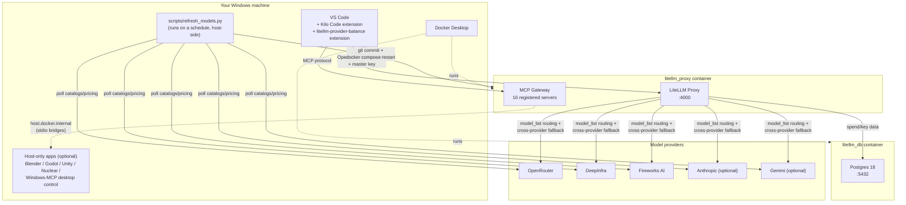
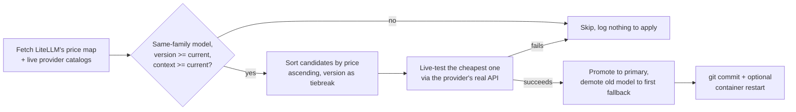
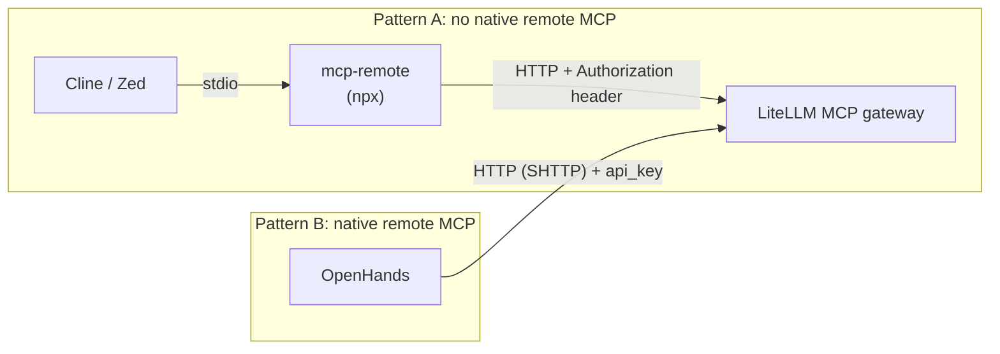

# Architecture & Implementation

How every piece of this project fits together, and why it's built this way.

## System overview



## Why LiteLLM as the hub

Instead of each tool (Kilo Code, other IDEs, agents) holding its own copy of
every provider API key and its own retry/fallback logic, everything points
at one local LiteLLM proxy. LiteLLM then:

- Picks the actual model per request based on `model_list` in
  [`config.yaml`](../config.yaml).
- Retries across providers automatically on error (`router_settings.fallbacks`).
- Tracks spend/keys in Postgres.
- Doubles as an **MCP gateway** — one place to register MCP servers so any
  connected client gets all of them, instead of configuring each server in
  every tool separately.

## The 5 Kilo Code modes, and why each model was picked

| Mode | Primary | Why | Fallback chain |
|---|---|---|---|
| **Code** | DeepInfra `DeepSeek-V4-Flash-0731` | Highest call volume — cheapest model still strong at coding/agentic tool-use | → OpenRouter (same model) → Fireworks (same model) |
| **Ask** | DeepInfra `Llama-3.3-70B-Turbo` | Already the best price/capability pick for general Q&A | → OpenRouter → Fireworks (same model) |
| **Debug** | DeepInfra `DeepSeek-V4.1-Flash` | Debugging benefits from the pricier reasoning checkpoint over raw Code mode | → OpenRouter → Fireworks (same model) |
| **Plan** | Fireworks `GLM-5.3-Flash` | Confirmed cheapest real price for a capable planning model | → OpenRouter → DeepInfra (same family) |
| **Orchestrator** | OpenRouter `GPT-5.6-Luna` | Lowest volume, but mistakes cascade to every sub-agent — kept on the strongest model rather than optimized for cost | → Fireworks `Kimi-K3` → DeepInfra `Kimi-K3` |

Two extra models, `claude` and `gemini`, are configured but deliberately
**not** in any mode or fallback chain — manual escape hatches for when you
specifically want them, not part of the automatic coding pipeline.

Every fallback chain spans a **different provider per hop** on purpose: a
DeepInfra outage doesn't take down Code mode, because the fallback runs on
OpenRouter or Fireworks instead.

## The MCP gateway

`mcp_servers` in `config.yaml` registers 16 servers behind one endpoint.
Three categories:

1. **Fully containerized, no external app needed** — filesystem, memory,
   sequential-thinking, fetch, Playwright, OpenStreetMap, DBHub,
   Postgres-Pro, SSH, the LSP bridge, the ffmpeg audio/video tool, Tripo3D.
2. **Containerized but need your own API key** — Meshy (3D gen),
   ElevenLabs (voice), Suno via AceDataCloud (music) — sit inert until you
   add a key to `.env`.
3. **Host-companion** — Blender, Godot, Unity, Nuclear, Windows desktop
   control. These need their real application running on your machine;
   the container either reaches out to it (`host.docker.internal`) or a
   host-side process is registered as a remote MCP server. See
   [MAINTENANCE.md](MAINTENANCE.md) for exact setup per app.

## The Docker image

`Dockerfile` extends the official `ghcr.io/berriai/litellm` image (a
minimal "Wolfi" Linux with Node and Python but no package managers) with:
`npm`, `pip`, `uv`/`uvx`, `ffmpeg`, `git`, `go` (used to compile
`mcp-language-server` and `gopls` at build time), and a tiny local
`npx-shim` package (see "Bugs found" in [STATUS.md](STATUS.md) for why that
shim exists).

## Model auto-refresh

`scripts/refresh_models.py` runs on the host (not in the container, since
it needs `git` and `docker compose`) on a weekly schedule. See
[STATUS.md](STATUS.md) for its design and [MAINTENANCE.md](MAINTENANCE.md)
for running/scheduling it yourself.



## The 5 editors/agents

`editors/` holds a per-tool folder (Cline, Zed, Aider, OpenHands, plus a
pointer for Kilo Code) each pointed at the same LiteLLM proxy + MCP
gateway. Two connection patterns recur:



Where a tool's *model provider* settings aren't in a plain file (Cline,
Kilo Code), that's a one-time manual UI step — deliberately not solved by
hacking a proprietary internal state file.

## Local Ollama (optional)

`scripts/setup_ollama.py` detects your GPU/RAM, and if it's worth it,
registers a local model as a same pattern as any other fallback leg — a
plain `model_list` entry with `model: ollama_chat/<name>` and
`api_base: http://host.docker.internal:11434` (Ollama runs on your host,
not in the container; the container reaches it the same way it reaches
Blender/Godot). It's appended only to Code/Ask's fallback chains, never a
primary — a small local model is a safety net, not a replacement for the
cloud models chosen for their coding capability.

## Workflow dashboard

`dashboard/app.py` is a small Flask app (not containerized — it needs to
run `docker compose`/`git`-adjacent commands and edit local files, which
is simplest as a host process) that reads the same LiteLLM APIs and
`.env` file everything else here uses. Its API-keys page doesn't just
write `.env` — it re-runs `editors/cline/install.py` and
`editors/zed/install.py` afterward, so a key rotation propagates
everywhere in one action instead of needing to remember every place a
key is duplicated.

## Model selection preference

`scripts/set_preference.py` writes `.model_preferences.json` (gitignored
— personal, not project config), which `refresh_models.py` reads to pick
one of ten modes:

| Mode | Behavior |
|---|---|
| `auto` / `cheapest_from_best` | Cost-first: cheapest same-family candidate, strong models only. Default. |
| `cheapest` | Cost-first: absolute lowest price, even over a newer version. |
| `most_accurate` / `performance` | Capability-first: always the newest version, cost secondary. |
| `free` | Only a genuinely $0 same-family candidate (see `is_free()`); does nothing if the family has no free variant — it never jumps to an unrelated free model. |
| `local` | Routes **Code/Ask only** to your local Ollama model as primary (see below); Debug/Plan/Orchestrator are untouched. |
| `local_cheapest` | Same local routing for Code/Ask; everything else (and Code/Ask too, if no local model is set up yet) uses `cheapest`. |
| `local_best` | Same local routing for Code/Ask; everything else uses `most_accurate`. |
| `custom` | Never auto-apply anything — always report-only, regardless of flags. |

The three `local*` modes need `scripts/setup_ollama.py` to have been run
first; if it hasn't, `refresh_models.py` prints a warning and falls back to
that mode's plain cloud equivalent (`auto`/`cheapest`/`most_accurate`) for
that run rather than silently doing nothing. Local routing is a direct
primary/fallback swap (`promote_local()`), not a price/version comparison
— there's nothing to compare a local model's price against, so it's a
deliberate opt-in choice via preference, distinct from the always-on,
fallback-only local safety net `setup_ollama.py` sets up by default (see
"Local Ollama" below) — that default never promotes local to primary on
its own; only explicitly choosing one of these three preferences does.

## Repository layout

```
.
├── config.yaml              # LiteLLM: models, fallbacks, MCP servers
├── docker-compose.yaml      # Postgres + LiteLLM containers
├── Dockerfile               # Extends LiteLLM's image with MCP runtimes
├── kilo.jsonc / kilo.json   # Kilo Code project config (see STATUS.md re: what actually works)
├── .env                     # All secrets (gitignored)
├── dashboard/
│   └── app.py               # Workflow dashboard (Flask, port 8877)
├── editors/
│   ├── cline/ zed/ aider/ openhands/ kilo-code/   # Per-editor setup + config templates
│   └── README.md
├── scripts/
│   ├── refresh_models.py    # Model auto-refresh
│   ├── set_preference.py    # Model-selection preference wizard
│   ├── setup_ollama.py      # Optional local-LLM integration
│   ├── schedule_refresh.*   # Registers the weekly schedule
│   └── requirements.txt
├── setup/
│   ├── setup.ps1 / setup.sh # One-click reproduction on a new machine
│   └── README.md
├── vscode-extension/
│   └── litellm-provider-balance/  # Status bar credit/balance indicator
└── docs/                    # You are here
```
