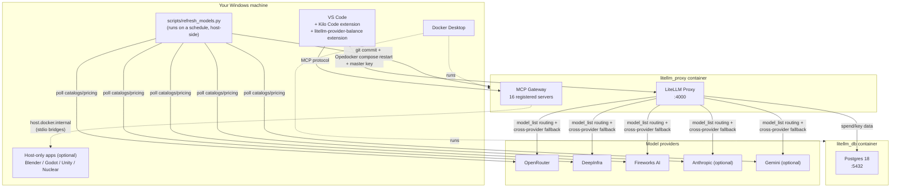
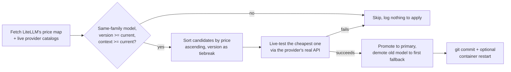
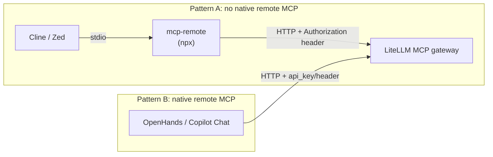

# Architecture & Implementation

How every piece of this project fits together, and why it's built this way.

## System overview



## Why LiteLLM as the hub

Instead of each tool (Kilo Code, other IDEs, agents) holding its own copy of
every provider API key and its own retry/fallback logic, everything points
at one local LiteLLM proxy. LiteLLM then:

- Picks the actual model per request based on `model_list` in
  [`config.yaml`](../config.yaml).
- Retries across providers automatically on error (`router_settings.fallbacks`).
- Tracks spend/keys in Postgres.
- Doubles as an **MCP gateway** — one place to register MCP servers so any
  connected client gets all of them, instead of configuring each server in
  every tool separately.

## The 5 Kilo Code modes, and why each model was picked

| Mode | Primary | Why | Fallback chain |
|---|---|---|---|
| **Code** | DeepInfra `DeepSeek-V4-Flash-0731` | Highest call volume — cheapest model still strong at coding/agentic tool-use | → OpenRouter (same model) → Fireworks (same model) |
| **Ask** | DeepInfra `Llama-3.3-70B-Turbo` | Already the best price/capability pick for general Q&A | → OpenRouter → Fireworks (same model) |
| **Debug** | DeepInfra `DeepSeek-V4.1-Flash` | Debugging benefits from the pricier reasoning checkpoint over raw Code mode | → OpenRouter → Fireworks (same model) |
| **Plan** | Fireworks `GLM-5.3-Flash` | Confirmed cheapest real price for a capable planning model | → OpenRouter → DeepInfra (same family) |
| **Orchestrator** | OpenRouter `GPT-5.6-Luna` | Lowest volume, but mistakes cascade to every sub-agent — kept on the strongest model rather than optimized for cost | → Fireworks `Kimi-K3` → DeepInfra `Kimi-K3` |

Two extra models, `claude` and `gemini`, are configured but deliberately
**not** in any mode or fallback chain — manual escape hatches for when you
specifically want them, not part of the automatic coding pipeline.

Every fallback chain spans a **different provider per hop** on purpose: a
DeepInfra outage doesn't take down Code mode, because the fallback runs on
OpenRouter or Fireworks instead.

### Kilo Code's other built-in agent behaviors

Kilo Code ships more built-in agents than the 5 above -- confirmed
directly from a real Settings screenshot rather than assumed: `architect`,
`code-reviewer`, `code-simplifier`, `code-skeptic`, `data`, `docs-specialist`,
`frontend-specialist`, plus `general` and `explore` (used for delegated
sub-agent work). `~/.config/kilo/kilo.jsonc`'s top-level `agent` object
supports arbitrary keys (confirmed against Kilo's own published config
schema, which marks `agent` as `additionalProperties`-open), so each of
these got a model binding rather than silently falling through to
whatever the UI's last-selected profile happens to be:

| Agent | Bound to | Why |
|---|---|---|
| `architect` | `kilo-plan` | Same job as Plan mode -- stress-testing designs |
| `code-reviewer` | `kilo-debug` | Review benefits from the stronger reasoning checkpoint, same logic as Debug mode |
| `code-simplifier` | `kilo-code` | Refactoring is still agentic coding work |
| `code-skeptic` | `kilo-debug` | Critical analysis, same reasoning tier as review/debug |
| `data` | `kilo-code` | Appending/executing notebook cells is agentic tool-use |
| `docs-specialist` | `kilo-ask` | Prose writing doesn't need the pricier reasoning tier |
| `frontend-specialist` | `kilo-code` | Frontend dev is still coding |

All 7 reuse an *existing* `config.yaml` model_name rather than getting a
fresh primary+fallback trio each -- keeps the surface manageable, and
any of them can be given its own independent model any time via the
dashboard's Custom Routing page (`/routing`), which already supports
adding a brand-new mode/model slot for exactly this.

## The MCP gateway

`mcp_servers` in `config.yaml` registers 16 servers behind one endpoint.
Three categories:

1. **Fully containerized, no external app needed** — filesystem, memory,
   sequential-thinking, fetch, Playwright, OpenStreetMap, DBHub,
   Postgres-Pro, SSH, the LSP bridge, the ffmpeg audio/video tool, Tripo3D.
2. **Containerized but need your own API key** — Meshy (3D gen),
   ElevenLabs (voice), Suno via AceDataCloud (music) — sit inert until you
   add a key to `.env`.
3. **Host-companion** — Blender, Godot, Unity, Nuclear. These need their
   real application running on your machine; the container either reaches
   out to it (`host.docker.internal`) or a host-side process is registered
   as a remote MCP server. See [MAINTENANCE.md](MAINTENANCE.md) for exact
   setup per app. **Desktop control is deliberately NOT in this list** — it
   is a local per-editor server instead (see "The power pack" below), so it
   never listens on a port.

## The Docker image

`Dockerfile` extends the official `ghcr.io/berriai/litellm` image (a
minimal "Wolfi" Linux with Node and Python but no package managers) with:
`npm`, `pip`, `uv`/`uvx`, `ffmpeg`, `git`, `go` (used to compile
`mcp-language-server` and `gopls` at build time), and a tiny local
`npx-shim` package (see "Bugs found" in [STATUS.md](STATUS.md) for why that
shim exists).

## Model auto-refresh

`scripts/refresh_models.py` runs on the host (not in the container, since
it needs `git` and `docker compose`) on a weekly schedule. See
[STATUS.md](STATUS.md) for its design and [MAINTENANCE.md](MAINTENANCE.md)
for running/scheduling it yourself.



## The 10 editors/agents (+1 subscription-gated bonus)

`editors/` holds a per-tool folder (Cline, Zed, Aider, OpenHands, Tabby,
Hermes, OpenCode, OpenWork, Goose, plus a pointer for Kilo Code) each
pointed at the same LiteLLM proxy + MCP gateway, plus an 11th (`copilot/`)
kept out of the main comparison since it needs an active GitHub Copilot
subscription just to function. Two connection patterns recur:



Where a tool's *model provider* settings aren't in a plain file (Cline,
Kilo Code), that's a one-time manual UI step — deliberately not solved by
hacking a proprietary internal state file.

Copilot Chat is the odd one out in two ways: its model routing goes
through a third-party open-source bridge extension
(`vivswan.litellm-vscode-chat`) rather than a setting the editor itself
exposes, and its MCP connection uses VS Code's *own* native MCP client
(workspace `.vscode/mcp.json`, Pattern B) rather than an editor-specific
config file — so unlike Cline/Zed it needs no `mcp-remote` bridge at all,
despite being the same VS-Code-extension shape as Cline. See
`editors/copilot/README.md` for why its master key is deliberately kept
out of that workspace file (a VS Code `inputs` prompt instead) when every
other editor's installer here just writes it straight into a user-profile
settings file.

**Tabby** is structurally different from all of the above: it isn't an
editor or an editor extension, it's its own self-hosted server (its own
Docker container, `editors/tabby/docker-compose.yml`) that a thin IDE
extension then connects to -- `IDE extension -> Tabby -> LiteLLM ->
providers`, one hop more than everything else here. It has no MCP client
of its own, so it isn't part of either pattern above. Its chat model and
completion model are each configured independently
(`[model.chat.http]` / `[model.completion.http]` in `config.toml`,
`kind = "openai/chat"` / `"openai/completion"`) -- both point at
LiteLLM, but completion quality depends on pointing at an actual
FIM-capable base model, not the chat/instruct models this project
otherwise uses (see `editors/tabby/README.md`). Unlike the Copilot bonus
above, Tabby needs no subscription at all -- the genuinely open-source
answer to "alternative to GitHub Copilot" the user asked for.

**Hermes Agent** ([hermes-agent.nousresearch.com](https://hermes-agent.nousresearch.com/))
is Pattern B (native HTTP for both model calls and MCP) and, like Tabby,
free/open-source with no subscription. Its own documentation names
LiteLLM as a supported provider by name -- `editors/hermes/config.yaml.template`
sets `providers.litellm.api`/`key_env` and `model.provider: custom:litellm`
per that documented recipe. Its `model.default` is `kilo-code`, not a
Hermes-branded model: Nous Research's own Hermes-3/4 models show no
tool-calling support on OpenRouter's live API, and are pricier than
`kilo-code` even on DeepInfra where tool support is confirmed -- a
coding agent that can't reliably call tools can't edit files or run
commands, so this project's cheapest-capable-with-tools pick applies
here too, not the app's own model branding (see `editors/hermes/README.md`
for the full price/tool-support comparison, checked against live
provider APIs before writing any of this).

**OpenCode / OpenWork / Goose** (the newest three) share `editors/_common/
common.py` (model discovery from the live proxy, env-var setting, the power
pack definition) instead of each carrying its own copy:

- **OpenCode** is the reference implementation: a `litellm` provider
  (`@ai-sdk/openai-compatible`), a remote `litellm-gateway` MCP entry, both
  authenticated through OpenCode's `{env:LITELLM_API_KEY}` substitution so
  no key is written to the file, and agent bindings that mirror the Kilo Code
  mapping above (`build`→kilo-code, `plan`→kilo-plan, `general`/`explore`→
  kilo-ask). Its installer uses a string-aware JSONC parser and keeps the
  old values in a header comment plus one backup.
- **OpenWork** *embeds* OpenCode: it layers its own generated runtime config
  and then each workspace's `opencode.jsonc`, so its installer
  (`editors/openwork/install.py`) reuses OpenCode's merge logic but targets
  the workspace files (auto-detected from OpenWork's server state) and does
  not rebind agents.
- **Goose** has a different config shape (custom-provider JSON + YAML
  extensions). Its native HTTP MCP extension did not send an
  `Authorization` header in testing, so it uses the same `mcp-remote` stdio
  bridge as Cline/Zed (Pattern A above).

### The power pack: local MCP servers, not gateway entries

Bringing an editor closer to Claude Desktop/Code means desktop control and
machine-wide file access — things a container can't see. Those are added as
**local stdio MCP servers per editor** (`desktop-commander`, and
`windows-mcp` on Windows), *not* registered in the gateway: the gateway
would need to reach a host process over a port, and `host.docker.internal`
is this machine's LAN IP, so that would expose desktop control beyond
loopback. Remote/SSH control, the browser and the rest already flow through
the gateway to every editor. See `editors/README.md` for the per-editor
matrix and the security note.

### Key rotation reaches every editor

The dashboard's API Keys page re-runs each installer that embeds the master
key (`cline`, `zed`, `hermes`, `opencode`, `openwork`, `goose`). The newer
ones run with `--no-rebind`, so rotating a key never resets a model or agent
choice you made in the editor since installing.

## Local Ollama (optional)

`scripts/setup_ollama.py` detects your GPU/RAM, and if it's worth it,
registers a local model as a same pattern as any other fallback leg — a
plain `model_list` entry with `model: ollama_chat/<name>` and
`api_base: http://host.docker.internal:11434` (Ollama runs on your host,
not in the container; the container reaches it the same way it reaches
Blender/Godot). It's appended only to Code/Ask's fallback chains, never a
primary — a small local model is a safety net, not a replacement for the
cloud models chosen for their coding capability.

## Workflow dashboard

`dashboard/app.py` is a small Flask app (not containerized — it needs to
run `docker compose`/`git`-adjacent commands and edit local files, which
is simplest as a host process) that reads the same LiteLLM APIs and
`.env` file everything else here uses. Its API-keys page doesn't just
write `.env` — it re-runs `editors/cline/install.py` and
`editors/zed/install.py` afterward, so a key rotation propagates
everywhere in one action instead of needing to remember every place a
key is duplicated.

## Model selection preference

`scripts/set_preference.py` writes `.model_preferences.json` (gitignored
— personal, not project config), which `refresh_models.py` reads to pick
one of ten modes:

| Mode | Behavior |
|---|---|
| `auto` / `cheapest_from_best` | Cost-first: cheapest same-family candidate, strong models only. Default. |
| `cheapest` | Cost-first: absolute lowest price, even over a newer version. |
| `most_accurate` / `performance` | Capability-first: always the newest version, cost secondary. |
| `free` | Only a genuinely $0 same-family candidate (see `is_free()`); does nothing if the family has no free variant — it never jumps to an unrelated free model. |
| `local` | Routes **Code/Ask only** to your local Ollama model as primary (see below); Debug/Plan/Orchestrator are untouched. |
| `local_cheapest` | Same local routing for Code/Ask; everything else (and Code/Ask too, if no local model is set up yet) uses `cheapest`. |
| `local_best` | Same local routing for Code/Ask; everything else uses `most_accurate`. |
| `custom` | Never auto-apply anything — always report-only, regardless of flags. |

The three `local*` modes need `scripts/setup_ollama.py` to have been run
first; if it hasn't, `refresh_models.py` prints a warning and falls back to
that mode's plain cloud equivalent (`auto`/`cheapest`/`most_accurate`) for
that run rather than silently doing nothing. Local routing is a direct
primary/fallback swap (`promote_local()`), not a price/version comparison
— there's nothing to compare a local model's price against, so it's a
deliberate opt-in choice via preference, distinct from the always-on,
fallback-only local safety net `setup_ollama.py` sets up by default (see
"Local Ollama" below) — that default never promotes local to primary on
its own; only explicitly choosing one of these three preferences does.

All of this is also reachable from the dashboard's **Preference** page —
same 10 modes, same behavior, just a click instead of a terminal command,
and anything but "custom" applies immediately (writes the preference,
runs the refresher for real, restarts the container). Choosing "custom"
there points you at **Custom routing** (see next section).

## Custom per-mode routing (dashboard)

`dashboard/app.py`'s `/routing` page is the "custom" preference made
concrete: every mode's exact model, editable directly, instead of letting
`refresh_models.py` choose. It reads/writes `config.yaml` through
`ruamel.yaml` rather than plain PyYAML specifically to preserve every
comment in the file across a save (plain `yaml.safe_load`/`yaml.dump`, as
`refresh_models.py` itself still uses, would silently strip all of them —
a real, still-open tradeoff on that script's side, acceptable there since
it runs occasionally and unattended, not acceptable for a page meant to
be saved from interactively and often). `/models` (`/api/models` as JSON)
backs its model picker: the same provider fetchers + LiteLLM price map
`refresh_models.py` uses, cached in memory for 5 minutes, listing only
providers with a key currently set. Adding a brand-new mode here only
creates an addressable `model_name` in LiteLLM — wiring an editor's own
custom-mode UI to that name is still a separate, per-editor step.

## Repository layout

```
.
├── config.yaml              # LiteLLM: models, fallbacks, MCP servers
├── docker-compose.yaml      # Postgres + LiteLLM containers
├── Dockerfile               # Extends LiteLLM's image with MCP runtimes
├── kilo.jsonc / kilo.json   # Kilo Code project config (see STATUS.md re: what actually works)
├── .env                     # All secrets (gitignored)
├── dashboard/
│   └── app.py               # Workflow dashboard (Flask, port 8877)
├── editors/
│   ├── cline/ zed/ aider/ openhands/ tabby/ hermes/ opencode/ openwork/ goose/ kilo-code/   # Per-editor setup + config templates
│   ├── _common/    # Shared helpers for the newest installers (model discovery, power pack)
│   ├── copilot/    # Bonus, subscription-gated -- see its own README
│   └── README.md
├── scripts/
│   ├── refresh_models.py    # Model auto-refresh
│   ├── set_preference.py    # Model-selection preference wizard
│   ├── setup_ollama.py      # Optional local-LLM integration
│   ├── schedule_refresh.*   # Registers the weekly schedule
│   └── requirements.txt
├── setup/
│   ├── setup.ps1 / setup.sh # One-click reproduction on a new machine
│   └── README.md
├── vscode-extension/
│   └── litellm-provider-balance/  # Status bar credit/balance indicator
└── docs/                    # You are here
```
