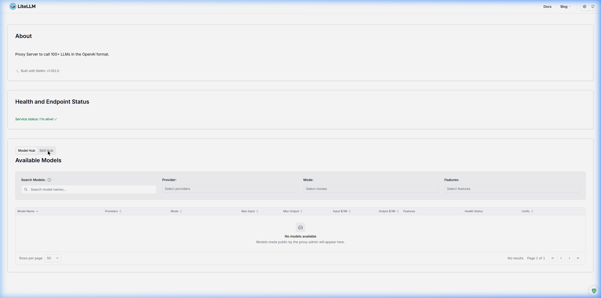
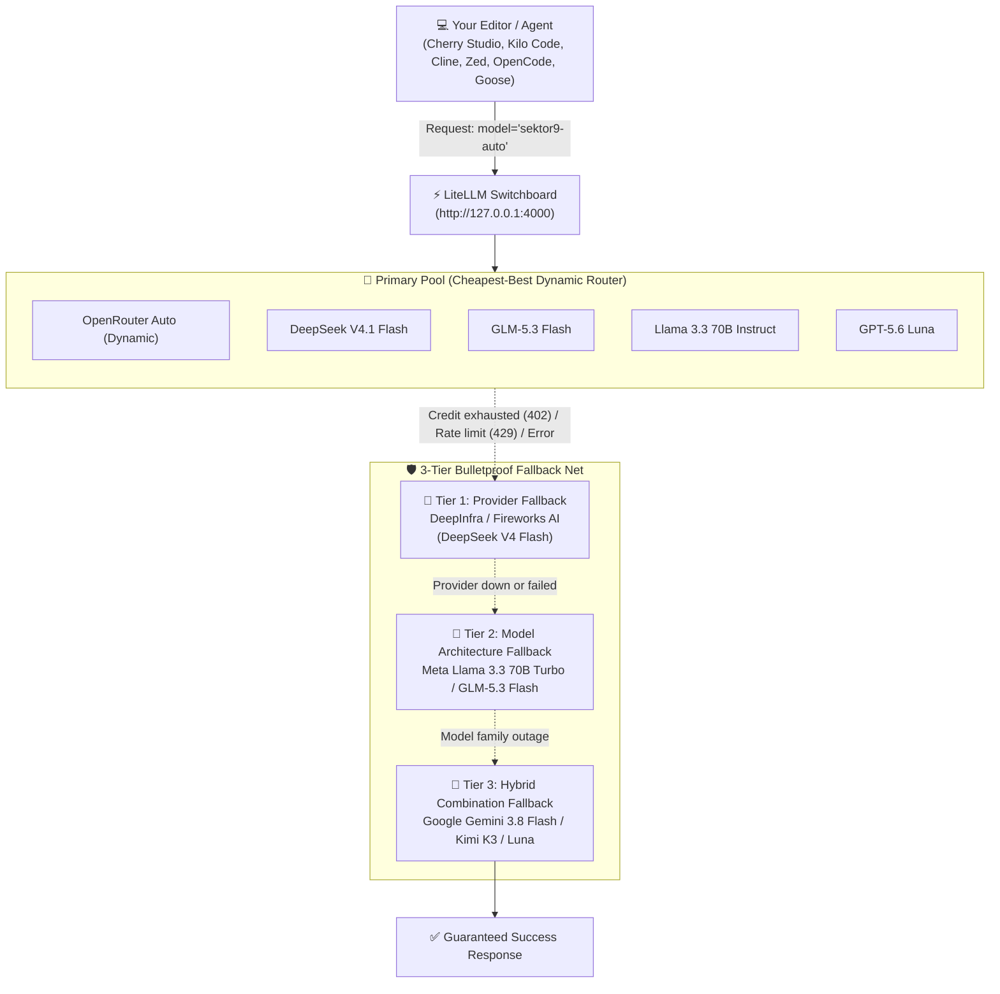

# 🚀 Sektor9 Auto & 3-Tier Fallback System (ELI5 Complete Guide)

> **👶 ELI5 (Explain Like I'm 5)**:
> Think of **Sektor9 Auto** as your ultimate AI super-assistant.
> Instead of you having to guess which AI model is currently the cheapest, fastest, or smartest for writing code, planning architecture, searching the web, or debugging, **Sektor9 Auto does it automatically!**
> 
> And if your credits run out on one website, or an API server goes down, you don't get an ugly error message—**Sektor9 Auto automatically catches the request and switches to backup providers and models without you lifting a finger!**

---

## 📸 Visual Tour & Dashboard Demo

Here is the live LiteLLM gateway running on your machine (`http://127.0.0.1:4000`):

| Screen | Description | Preview |
|---|---|---|
| **Login Screen** | Admin authentication using your `LITELLM_MASTER_KEY` |  |
| **API & Hub Dashboard** | Live proxy interface managing models, MCP tools, and routing |  |
| **Model Catalog** | All registered Sektor9 execution types and fallback tiers |  |

### 🎥 Recorded Session Video
A full recorded browser session exploring the dashboard is saved here:
`docs/images/litellm-dashboard-demo.webp`

---

## 🧠 Architecture: How Sektor9 Auto Thinks



---

## 🛡️ The 3 Fallback Tiers Explained

### 1. 🔹 Tier 1: API Provider Fallback (`sektor9-auto-fallback-provider`)
- **ELI5 Analogy**: *"Your favorite grocery store is closed, so you go across the street to buy the exact same milk from another store."*
- **What it does**: If **OpenRouter** runs out of prepaid credit, returns HTTP `402 Payment Required`, hits a rate limit `429`, or encounters a 5xx gateway error, LiteLLM immediately redirects the exact same prompt to **DeepInfra** or **Fireworks AI**.
- **Models**:
  - `deepinfra/deepseek-ai/DeepSeek-V4-Flash-0731`
  - `fireworks_ai/deepseek-v4-flash-0731`
  - `deepinfra/deepseek-ai/DeepSeek-V4.1-Flash`

### 2. 🔹 Tier 2: Model Architecture Fallback (`sektor9-auto-fallback-model`)
- **ELI5 Analogy**: *"The chocolate flavor ran out completely, so you get top-shelf vanilla instead."*
- **What it does**: What if the entire DeepSeek server farm is experiencing a worldwide outage? Switching providers won't help if the model itself is frozen. Tier 2 switches the *brain architecture* to a completely different frontier model with equivalent reasoning capacity.
- **Models**:
  - `deepinfra/meta-llama/Llama-3.3-70B-Instruct-Turbo`
  - `fireworks_ai/glm-5p3-flash`
  - `deepinfra/zai-org/GLM-5.3`

### 3. 🔹 Tier 3: Hybrid Combination Fallback (`sektor9-auto-fallback-hybrid`)
- **ELI5 Analogy**: *"The ultimate emergency parachute that never fails."*
- **What it does**: A completely different cloud infrastructure AND a high-resilience frontier model. Even in a catastrophic multi-provider outage, your request gets fulfilled.
- **Models**:
  - `gemini/gemini-3.8-flash` (via Google Gemini API key)
  - `fireworks_ai/kimi-k3`
  - `deepinfra/moonshotai/Kimi-K3`

---

## 🛠️ How to Modify Sektor9 Auto

All configurations live in [`config.yaml`](../config.yaml).

### A. Adding a New Model to the Sektor9 Auto Pool
Under `model_list`, locate `# ── [Primary Pool]: OpenRouter Default`:
```yaml
  - model_name: sektor9-auto
    litellm_params:
      model: openrouter/your-new-provider/model-name
      api_key: os.environ/OPENROUTER_API_KEY
```
LiteLLM's `routing_strategy: "cost-based-routing"` will automatically check its $/token price and route to it whenever it's the cheapest capable option!

### B. Adjusting Fallback Targets
Locate `router_settings.fallbacks` around line 400:
```yaml
router_settings:
  routing_strategy: "cost-based-routing"
  num_retries: 2
  timeout: 180
  fallbacks:
    - { "sektor9-auto": ["sektor9-auto-fallback-provider", "sektor9-auto-fallback-model", "sektor9-auto-fallback-hybrid"] }
```
You can reorder the fallback priorities or add new fallback names simply by editing that list.

### C. Testing Your Changes in 3 Seconds
Run our automated tester script:
```powershell
python scripts/test_sektor9_auto.py
```
Output:
```text
[1] Querying /v1/models...
    Total models registered: 55
    [+] Sektor9 Auto and all 3 Fallback tiers are present in LiteLLM!
[2] Testing chat completion via Sektor9 Auto...
    [+] Response received from model 'sektor9-auto': ...
>>> ALL TESTS PASSED! Sektor9 Auto router is operational! <<<
```

---

## 🔌 Connecting Your Favorite Editor to Sektor9 Auto

| Editor | How Sektor9 Auto is Wired | How to Apply |
|---|---|---|
| **🍒 Cherry Studio** | Automatic SQLite config: default assistant + agents bound to `sektor9-auto` with `bypassPermissions` | `python editors/cherry-studio/install.py` |
| **⚡ Kilo Code (VS Code)** | Configured in `sektor9.json` / `sektor9.jsonc` as primary provider & `auto`/`explore` agent | Open Kilo Code Settings → Model: `sektor9-auto` |
| **🤖 OpenCode** | Rebinds `model`, `general`, and `explore` to `litellm/sektor9-auto` | `python editors/opencode/install.py` |
| **🪿 Goose** | Sets `GOOSE_MODEL: sektor9-auto` in config | `python editors/goose/install.py` |
| **🪶 Hermes Agent** | Sets `model.default: sektor9-auto` in `config.yaml` | `python editors/hermes/install.py` |
| **⚡ Zed** | Registered in `available_models` under `openai_compatible.litellm` | `python editors/zed/install.py` |
| **🐱 Tabby** | Points `[model.chat.http]` to `sektor9-auto` | Configured in `editors/tabby/data/config.toml` |
| **🤝 OpenWork** | Auto-configured via embedded OpenCode runtime | `python editors/openwork/install.py` |
| **🦾 OpenHands** | Points `[llm].model` to `openai/sektor9-auto` | Configured in `editors/openhands/config.toml.template` |
| **💻 Cline** | Select `OpenAI Compatible`, Model ID: `sektor9-auto` | Guided in `editors/cline/README.md` |
| **🐙 GitHub Copilot** | Select `sektor9-auto` from chat model picker | `python editors/copilot/install.py` |

---

## ❓ FAQ (Frequently Asked Questions)

### Q: What is the difference between `sektor9-autorouter` and `sektor9-auto`?
- **`sektor9-autorouter`** was the initial dynamic cost balancer across 5 models, but lacked explicit tiered fallback chains.
- **`sektor9-auto`** is the new execution type featuring:
  1. Full execution type coverage (Code, Plan, Execute, Search, Debug, Ask).
  2. The 3-Tier Fallback Chain (Provider -> Model Architecture -> Hybrid Frontier Parachute).
  3. Pre-configured aliases (`auto`, `sektor9auto`) for clean editor integrations.

### Q: Do I need to restart Docker after editing `config.yaml`?
Yes! Whenever you touch `config.yaml`:
```powershell
docker compose restart litellm
```
LiteLLM reloads in ~10 seconds.
