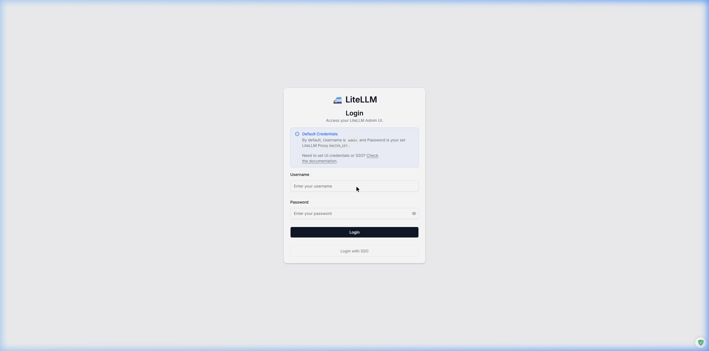
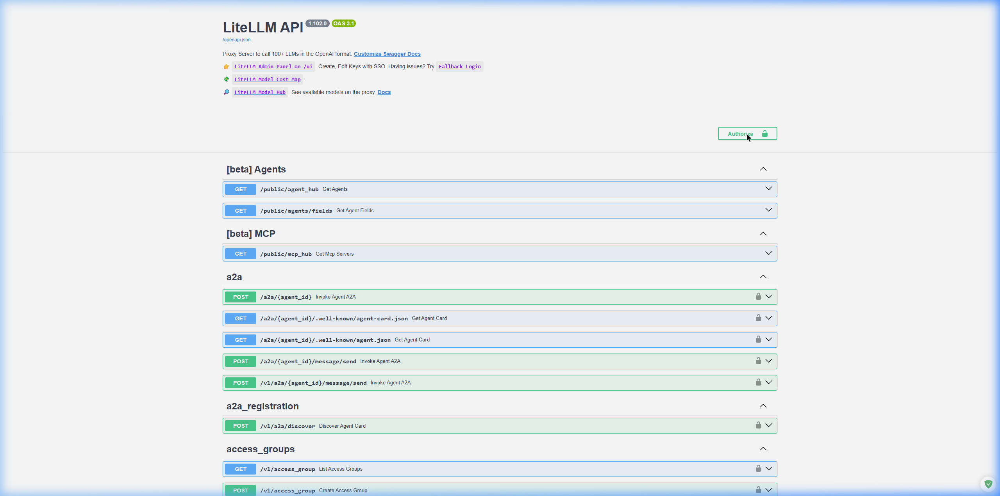

# User guide (explain it like I'm new to this)

No prior Docker/API/coding-tool experience assumed. If a word confuses you,
check the [Glossary](#glossary) at the bottom.

## What is this thing, actually?

Picture your AI coding assistant (Kilo Code, in VS Code) as a phone that
needs to call one of several AI "operators" (OpenRouter, DeepInfra,
Fireworks, and a couple of others) every time it needs to think. Without
this project, that phone would need every operator's phone number
memorized, and if one operator's line was busy, the call would just fail.

**LiteLLM is a switchboard** that sits between your coding assistant and
all those operators. Your assistant dials one number (the switchboard),
says which "department" it needs (Code / Ask / Debug / Plan / Orchestrator
— these map to what Kilo Code is trying to do), and the switchboard:

- picks the cheapest good operator for that department,
- and if that operator's line is busy or down, **automatically tries the
  next one** — your assistant never even notices.

It also runs as a **toolbox gateway**: instead of teaching your coding
assistant how to use a database, a browser, a filesystem, etc. one at a
time in every single tool you use, they're all registered once here, and
anything that connects gets the whole toolbox.

It all runs in **Docker** — think of Docker as a shipping container for
software: everything this needs (a database, the switchboard program) is
sealed inside two containers on your machine, so it doesn't clutter up or
conflict with anything else installed on your PC.

## The pieces, in plain terms

| Piece | What it actually does |
|---|---|
| **LiteLLM** | The switchboard. Runs at `http://localhost:4000` on your own machine — nothing about it is on the internet, only reachable from your PC. |
| **Postgres** | A database, used only to remember usage/spend and account keys for the switchboard itself. |
| **Docker Desktop** | The app that runs the two containers (LiteLLM + Postgres). If it's not running, nothing else works. |
| **Kilo Code** | The AI coding assistant extension in VS Code — what you actually type into. |
| **MCP servers** | Individual "tools" (talk to a database, control a browser, edit audio, etc.) that Kilo Code (or anything else connected) can use through LiteLLM. |
| **The status bar extension** | A little indicator at the bottom-right of VS Code showing how much credit is left on each AI operator. |

## How do I know it's working?

1. Open a terminal (PowerShell) and run:
   ```powershell
   docker ps
   ```
   You should see two containers, `litellm_proxy` and `litellm_db`, both
   saying "Up".
2. Open `http://localhost:4000` in a browser — you should see a login
   screen like this:

   

   Username `admin`, password is your `LITELLM_MASTER_KEY` from `.env`
   (open that file in any text editor to find it).
3. Once logged in, you'll land on the dashboard:

   

   The left sidebar has **Models + Endpoints** (every AI model it can use)
   and **MCP Servers** (every tool it can use) — click either to see the
   full list and each one's live status (a green dot = working).

## Checking how much credit you have left

Two ways:
1. **The status bar** in VS Code (bottom-right, after installing the
   `litellm-provider-balance` extension) shows a live summary — click it
   for a menu with more detail and direct links to each provider's own
   billing page.
2. **Each provider's own website** — OpenRouter, DeepInfra, Fireworks each
   have a billing/credits page; the status bar's menu links directly to them.

## Using Kilo Code day-to-day

You don't need to think about any of this most of the time — open VS Code,
use Kilo Code normally. Behind the scenes, whichever mode you're in (Code,
Ask, Debug, Plan, Orchestrator — visible in Kilo Code's own mode picker)
is quietly going through the switchboard. If you ever want to deliberately
use Claude or Gemini instead of your usual coding models, they're
available too — just pick them from Kilo Code's model dropdown, they're
not tied to any particular mode.

## What if something breaks?

**"Kilo Code says it can't connect"**
- Is Docker Desktop actually running? Check the system tray icon.
- Run `docker ps` — are both containers "Up"? If not:
  ```powershell
  cd D:\Projects\LiteLLM
  docker compose up -d
  ```

**"It says I'm out of credit / a request failed"**
- Check the status bar extension, or the provider's own website, for that
  specific provider. Every mode has automatic backups on *other*
  providers, so one running low shouldn't fully stop you — but if all of a
  mode's providers are out, you'll need to top up at least one.

**"I changed something and now it's broken"**
- Every change to this project is saved in git. You (or an AI assistant
  helping you) can always undo the most recent change:
  ```powershell
  git log --oneline -10        # see recent changes
  git revert <the-commit-id>   # undo one of them
  ```
  See [MAINTENANCE.md](MAINTENANCE.md) for more.

**"I got a new PC / reformatted"**
- See [`setup/README.md`](../setup/README.md) — one script rebuilds
  everything, it'll just ask you for your API keys again.

## Glossary

- **API key** — a password-like secret string that lets a program (not a
  person) log into a service on your behalf.
- **Container** — an isolated, self-contained bundle of a running program;
  Docker's unit of "one thing running."
- **Docker Desktop** — the app that manages containers on Windows/Mac.
- **Provider** — a company selling access to AI models (OpenRouter,
  DeepInfra, Fireworks, Anthropic, Google).
- **Model** — a specific AI (e.g. "DeepSeek V4 Flash") offered by a provider.
  Different models cost different amounts and are better/worse at different
  tasks.
- **Fallback** — a backup model tried automatically if the first choice
  fails or is unavailable.
- **MCP (Model Context Protocol)** — the standard way an AI assistant asks
  a "tool" (a database, a browser, a file system) to do something on its
  behalf.
- **`.env` file** — a plain text file holding all your secret keys. Never
  shared, never uploaded to GitHub (see `.gitignore`).
- **`config.yaml`** — the file that tells LiteLLM which models/tools exist
  and how they're wired together.
- **Repository ("repo")** — the folder of files for this whole project,
  tracked by git so every change has a history.
